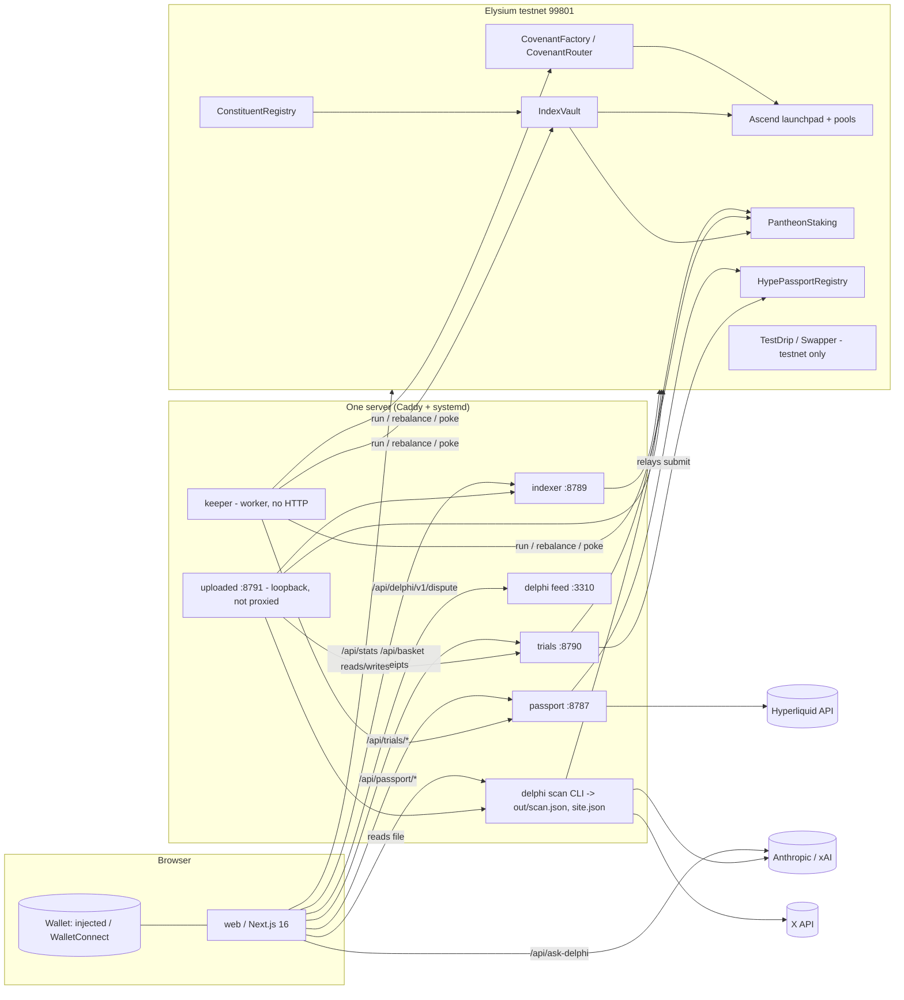
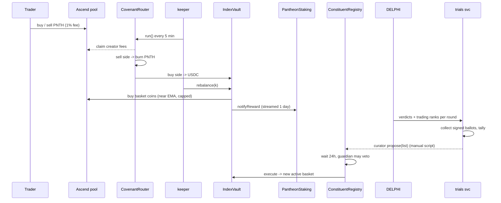
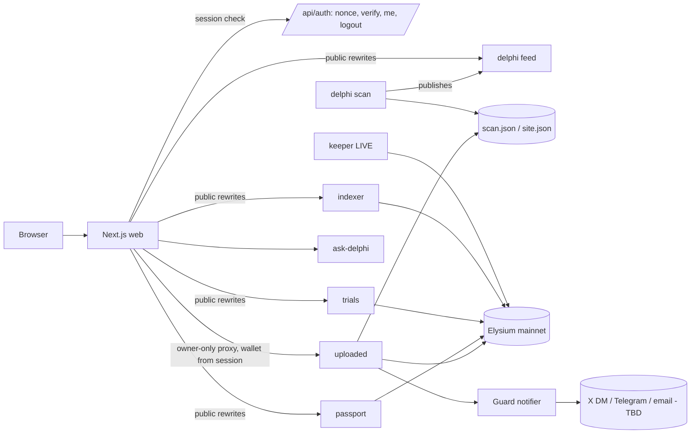
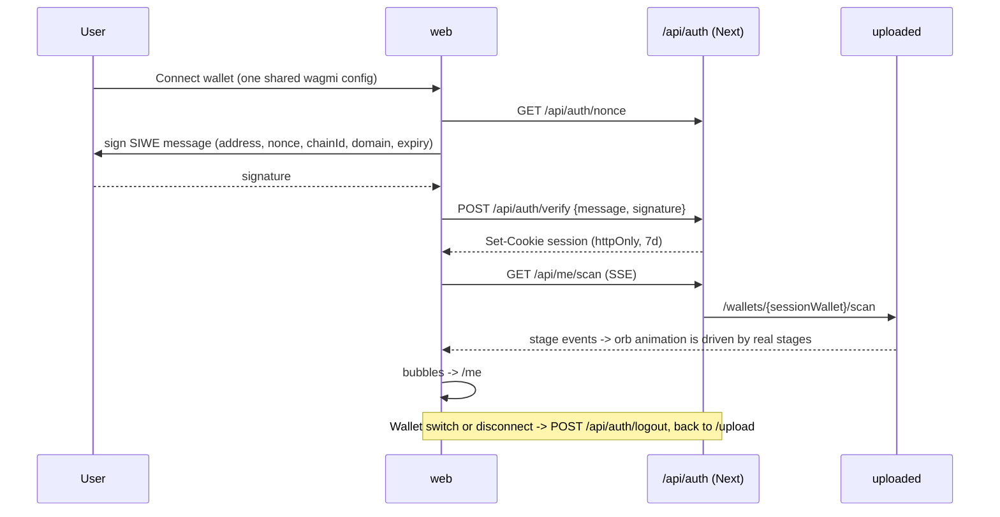
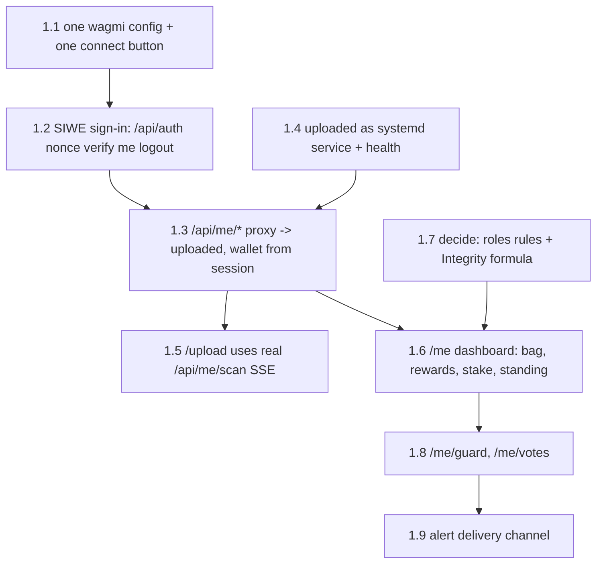

# PANTHEON architecture

What exists, what the finished product looks like, and what to build in what order.
Written Nov 3, 2026 from the code on `main` (`ccde39f`), the live site, and @pantheonindex / @AscendLaunch on X.
**Hard date (from public posts, not the repo): Elysium mainnet and Ascend go live Nov 9, 2026.** The repo has no mainnet deployment or chain config yet.

Status legend: **DONE** works end to end · **HALF** real code, not wired or not public · **STUB** placeholder · **DEAD** not used by the product.

---

## 1. What PANTHEON is

An index token for Ascend (the launchpad on Elysium, Kinetiq's Hyperliquid L2).

- **Money loop:** every PNTH trade pays Ascend's 1% fee → half to PNTH's **Covenant** (ownerless router) → buy-side fees fill a **basket** of up to 10 Ascend coins streamed to **stakers**; sell-side fees **burn** PNTH (15% team share on mainnet).
- **Governance:** **The Trials**: stakers sign free ballots to vote 3 coins per round into the basket; the rest are picked by real trading. A 24h on-chain timelock + guardian veto.
- **Trust layer:** **DELPHI**: scans every Ascend / Kalos / PerpMe coin for bundles, wash trading, whales, contract powers; a flagged coin can't enter the basket. Has a chat (`/delphi/chat`) and an X bot.
- **Sybil / boost layer:** **HYPE Passport**: proves HYPE held on Hyperliquid without revealing the wallet; ≤1.25× staking boost and +1..3 votes.
- **Newest direction (Oct 31 → now): "Get uploaded"**: connect + sign, DELPHI reads your wallet, and you get a personal **space** (your bag with verdicts, rewards, stake, voting record, Guard alerts, standing/roles). The backend for this is built; the UI stops at "Your space opens here soon."

---

## 2. What exists now

### 2.1 System map

### 2.2 Contracts (`src/`)

| Contract | Does | Status |
|---|---|---|
| `CovenantFactory` | `launch`, `adopt`, `predictRouter`, `policyHash` | DONE, verified on testnet |
| `CovenantRouter` | `run()` routes creator fees by fixed legs (burn / pay / basket / stream); `deliverLeg` for deferred legs | DONE |
| `ConstituentRegistry` | `propose` (curator), `veto` (guardian), `execute` after 24h; `active()` | DONE |
| `IndexVault` | `rebalance(k)` buys basket near Ascend EMA, `flush`, streams to staking | DONE |
| `PantheonStaking` | `stake`, `requestUnstake` (3d), `cancelUnstake`, `withdraw`, `claim`, `poke`, `notifyReward`, time bonus ≤1.5×, Passport ≤1.25× | DONE (testnet copy predates `retiredTokens`) |
| `HypePassportRegistry` | `submit` EIP-712 attestation, `unlink`, `retire`, `tierOf`, `multiplierOf` | DONE |
| `AscendSwap` / Swapper, `TestDrip` | testnet helpers | DONE, **testnet-only** |
| TASKS.md items: `LinearVesting`, `TrialsBallot` (on-chain tally), KNTQ buy-and-burn | — | **Never built** (Trials went off-chain with signed ballots instead). TASKS.md is stale. |

Tests: ~39 Foundry test functions in `test/` (unit, Passport, fork). CI runs `forge fmt/build/test` only; **no CI for web or services**.

### 2.3 Services (`services/`)

| Service | Port / form | Endpoints | Status |
|---|---|---|---|
| **indexer** | :8789 | `GET /health /stats /basket /receipts?kind&account&token&limit&before` | DONE, live (24 tests) |
| **passport** | :8787 | `GET /passport/stats /passport/pokes?since /passport/:address /health`, `POST /passport/challenge /verify /refresh` | DONE, live. 1 test file fails: `docs/passport-fixtures/` missing from repo |
| **trials** | :8790 | `GET /health /trials/current?voter /trials/rounds/:n`, `POST /trials/vote` | DONE, live (34 tests). Note: `?voter=` shows that wallet's ballot to anyone |
| **delphi scan** | CLIs in `scripts/` (scan, explain, kalos, perpme, safety, trials, x, fresh-read…) | writes `out/scan.json`, `out/site.json` | DONE (490 tests). Run by an external scheduler not in the repo |
| **delphi feed** | :3310 | `GET /v1/token/:a /v1/tokens?ids /v1/new /v1/history/:a /v1/health /v1/format`, `POST /v1/dispute` | **HALF**: server + store done, **nothing writes real records into it** (only tests / fake loaders). Dispute works. |
| **delphi X bot** | CLI `scripts/x.ts` | — | DONE behind flags |
| **uploaded** ("Get uploaded" backend) | :8791 loopback | `GET /health /coins/:t /basket /trials/round /trials/campaigns[/:t]`, `GET /wallets/:a/{holdings,history,bag,standing,footprint,elsewhere,trials/record,trials/ballot,guard,rewards,stake,stake/unstake-preview,scan(SSE)}` | **HALF**: all readers built and tested (368 tests), **no auth, no Next rewrite, no systemd unit**, not reachable from the site |
| **keeper** | worker, 5-min loop | none | DONE; **practice mode by default**. Must be in live mode with a funded key for mainnet |

### 2.4 Web (`web/src/app`)

| Route | What it shows | Data source | Status |
|---|---|---|---|
| `/` | Hero, live numbers, how it works, what you get, basket | indexer + trials + DELPHI file (server, cached) | DONE. **Basket / how-it-works / what-you-get use hardcoded example coins (HELIOS, AETHER…)**, not the real basket |
| `/get` | Get test USDC/PNTH (drip or swap) | chain (wagmi) | DONE, **testnet-only** |
| `/stake` | Stake, unstake, claim | chain | DONE; does not use uploaded's unstake-preview (bonus-loss warning) |
| `/passport` | Feature page | static | DONE |
| `/passport/get` | Link Hyperliquid → sign → relay | passport API + chain | DONE |
| `/passport/me` | Passport book + stamps | chain | DONE (newest, Nov 2) |
| `/trials` | Feature page | static | DONE |
| `/trials/vote` | Current round, sign ballot | trials API | DONE |
| `/delphi` | All coins + verdicts | `services/delphi/out/site.json` read from disk | DONE (needs web + delphi on same box) |
| `/delphi/[token]` | Coin report | same file | DONE |
| `/delphi/kalos` | Kalos + PerpMe coins | same file | DONE, unlisted |
| `/delphi/chat` | Ask DELPHI (streamed) | `/api/ask-delphi` → Claude / Grok / reports | DONE |
| `/delphi/dispute` | Dispute a check | delphi feed `/v1/dispute` | DONE, unlisted |
| `/covenant` | Feature page | static | DONE |
| `/covenant/launch` | Launch a coin on Covenant | chain | DONE |
| `/security`, `/terms` | Static | static | DONE |
| `/upload` | Connect → sign → orb → bubbles → **"Your space opens here soon"** | none (the 24s read is a canned animation) | **STUB after the signature** |
| `/api/ask-delphi` | Only API route in web | Anthropic / xAI | DONE, rate-limited, signed answers |

Other: `lab/touch/` is a Vite design lab whose pieces were copied into `web/src/components` → **DEAD for production** (keep as sandbox, never import). `web/README.md` is the create-next-app default. Menu items without `href` show "soon".

### 2.5 How data flows today

---

## 3. Target architecture (finished product)

### 3.1 Principles

1. **One wallet identity across the site.** Today each app screen mounts its own `Providers`; `/upload` has its own wagmi config with WalletConnect. Target: one config (injected + WalletConnect), one connect button, one session.
2. **One sign-in.** The "Get uploaded" signature becomes **SIWE-style sign-in** (EIP-4361 message, nonce, httpOnly session cookie). Everything owner-only (`elsewhere`, `footprint` approvals, `guard`, `record`) is behind it.
3. **One public gateway.** The browser only ever calls `/api/*` on pantheonindex.com. Next rewrites to services; owner-only routes go through a Next route handler that checks the session and adds the wallet itself (the browser never chooses whose data it gets).
4. **Network is a setting, not a code change.** `NEXT_PUBLIC_DEPLOYMENT=elysium-mainnet` picks the mainnet chain id (confirm from Elysium docs), addresses, explorer, RPC. Testnet-only screens hide themselves.
5. **Real data or say "example".** Landing sections read the live basket.

### 3.2 Target system

### 3.3 Every screen and what it needs

| # | Screen | Route | Backend it depends on | Exists? |
|---|---|---|---|---|
| 1 | Landing | `/` | indexer `/stats` `/basket`, trials `/current`, DELPHI counts | yes, swap example basket for live |
| 2 | Get PNTH | `/get` | mainnet: Ascend pool deep link / swap; testnet: drip | testnet only |
| 3 | Stake | `/stake` | chain + uploaded `/wallets/me/stake`, `/stake/unstake-preview`, `/rewards` | yes, add preview + rewards |
| 4 | **Your space** (dashboard) | `/me` (target of `/upload`) | `/api/me/*` → uploaded: `bag`, `rewards`, `stake`, `standing`, `guard`, `trials/record`, `trials/ballot` | **no** |
| 4a | Your bag | `/me/bag` | `bag`, `footprint` (tokens, approvals) | no |
| 4b | Guard alerts | `/me/guard` | `guard` + notification prefs (new) | no |
| 4c | Voting record | `/me/votes` | `trials/record` | no |
| 4d | Standing / roles | `/me` header | `standing` + **role rules (not defined)** | no |
| 5 | Get uploaded (onboarding) | `/upload` | `/api/auth/*`, `/api/me/scan` (SSE) | UI yes, wiring no |
| 6 | Passport feature / get / me | `/passport*` | passport API, chain | yes |
| 7 | Trials feature / vote | `/trials`, `/trials/vote` | trials API; uploaded `ballot` for "can I vote / why not" | yes |
| 8 | Campaign page + share card | `/trials/[token]` | uploaded `/trials/campaigns/:t` | **no** |
| 9 | Basket detail | `/basket` (today `/#basket`) | uploaded `/basket` or indexer `/basket` + `/receipts` | **no** (only landing section) |
| 10 | Receipts / activity | `/receipts` (TASKS had `/r/:pool`) | indexer `/receipts` | **no** |
| 11 | DELPHI index / report / kalos / chat / dispute | `/delphi*` | DELPHI file → target: feed | yes |
| 12 | Check any coin | search box → `/delphi/[token]` | uploaded `/coins/:t` (fresh read) | **no** |
| 13 | Covenant feature / launch | `/covenant*` | chain | yes |
| 14 | Security, Terms | static | — | yes, update addresses for mainnet |

### 3.4 Auth and state flow

Client state: wagmi (wallet/chain), react-query (server data, keys like `['me','bag']`), session cookie (identity). No global store needed.

### 3.5 Data models the UI consumes (already defined by services)

- **Coin verdict**: `{token, symbol, venue, verdict: FLAG|WATCH|CLEAN|NOT_ENOUGH_DATA|UNKNOWN, reason, findings[{tx}], reportUrl, disputeUrl, scannedAt, stale, checking}`
- **Bag**: `{coins[], counts, sentIn[], wholeWallet, unread[], complete, checking}`
- **Stake**: `{staked, cooling, coolEnd, canWithdraw, timeBonus, passportBoost, multiplier{earning, ifRefreshed}, needsRefresh}`
- **Rewards**: `{coins[{token, claimable, claimed, earned, verdict}], recentClaims, passportBoost}`
- **Standing**: `{firstSeen, staking, roundsVoted, coinsLaunched, passport, complete}`
- **Guard alert**: `{kind: verdict-drop|creator-sold, coin, at, reason, evidence[], from, to | soldPct}`
- **Round / campaign**: `{round, status, closesAt, seats, candidates[{votes, voters, rank, inSeat, votesNeeded, verdict, share}]}`
- **Passport**: `{tier 0..3, stamps bitmask, multiplier, issuedAt, expiry, linkedAt}`

**New models to add:** `Session {wallet, chainId, issuedAt, expiresAt}`; `Role` rules over Standing (Staker / Councillor / Creator / Pillar / Genesis); `AlertPrefs {wallet, channel, handle}`; `Integrity` (decision: by coin count or by value).

---

## 4. Gap list, ordered by dependency

### Tier 0: mainnet day one (Nov 9). Nothing else matters if these slip.

| # | Gap | Blocks |
|---|---|---|
| 0.1 | `deployments/elysium-mainnet.json` + `web/.../deployments` entry; web `elysium` chain built from the deployment (id, RPC, explorer), not hardcoded `99801`, `deployedFrom` per network | every screen on mainnet |
| 0.2 | Run `Deploy.s.sol` on mainnet (Passport registry, factory, PNTH via Covenant with `TEAM_BPS=1500`, registry, staking, vault), verify, update `/security` | 0.3–0.5 |
| 0.3 | Point indexer, passport, trials, keeper, delphi at mainnet; keeper to `KEEPER_MODE=live` with funded gas key | live numbers, basket buys, boosts |
| 0.4 | Hide testnet-only UI on mainnet (`/get` drip, Swapper, "test USDC" copy); `/get` → link to PNTH on Ascend / fomo | `/get` |
| 0.5 | Multisigs for curator and team; guardian (Ascend or multisig) | first basket proposal (~day 4) |
| 0.6 | Add `docs/passport-fixtures/` (passport test fails), CI job for `web` lint/build and each service `npm run check` | safe changes during launch week |

### Tier 1: unlock "Your space" (the screen you're actually stuck on)

| # | Gap | Notes |
|---|---|---|
| 1.1 | Merge `upload-config.ts` and `lib/chain/config.ts` into one wagmi config; one `Providers` in the root layout instead of per screen | otherwise sign-in can't follow you between pages |
| 1.2 | `/api/auth/{nonce,verify,me,logout}` (Next route handlers, SIWE, httpOnly cookie) | the existing "Get uploaded" message is close; add nonce + domain + expiry |
| 1.3 | `/api/me/[...path]` handler: read session → call `uploaded` `/wallets/{wallet}/...` | never let the browser pass the address for owner-only data |
| 1.4 | Install `uploaded` like the others (systemd unit, runs as DELPHI's user for fresh reads) | README says not installed yet |
| 1.5 | Drive the orb from real `scan` stages instead of the canned 24 s | stages: history, holdings, verdicts, firstDay, firstTx, standing, footprint, wholeBag |
| 1.6 | `/me` page | needs 1.3 + 1.7 |
| 1.7 | **Your decisions** (backend README explicitly waits on you): role rules, Integrity by count vs value, what happens to a candidate that turns FLAG mid-round, whether USDC/WHYPE count as CLEAN | blocks /me header and Integrity number |
| 1.8 | Guard and voting record screens | data ready |
| 1.9 | How alerts reach people (X DM, Telegram, email, in-app only) | blocks Guard being useful |

### Tier 2: public pages fed by data that already exists

| # | Gap | Depends on |
|---|---|---|
| 2.1 | Rewrite `/api/uploaded/basket`, `/api/uploaded/coins/:t`, `/api/uploaded/trials/*` (public, no wallet) | 1.4 |
| 2.2 | Landing basket / how-it-works use live basket, label example only when empty | 2.1 or indexer `/basket` (already proxied) |
| 2.3 | `/basket` page with buys + receipts | indexer `/receipts` (already proxied) |
| 2.4 | `/trials/[token]` campaign page + OG share card | 2.1 |
| 2.5 | "Check any coin" search → `/delphi/[token]`, with `checking` state | 2.1 |
| 2.6 | `/stake`: unstake-preview warning (unstaking any amount resets the time bonus), rewards per coin with verdict | 1.3 or public `/wallets/:a/stake` |
| 2.7 | `/trials/vote`: "why can't I vote" from `ballot.whyNot` | 1.3 |

### Tier 3: hardening and cleanup

| # | Gap |
|---|---|
| 3.1 | DELPHI feed producer: scan writes into `FeedStore` so `/v1/*` serves real records; then web reads the feed instead of a file on disk (lets web and delphi live on different boxes) |
| 3.2 | Trials: stop `/trials/current?voter=` exposing a ballot during an open round (or accept it as public by design) |
| 3.3 | Paid RPC for uploaded/indexer before launch-day load (READMEs warn the public node refuses batches) |
| 3.4 | Update `TASKS.md` (still the Oct 18 submission plan), replace `web/README.md`, add uploaded to root README table |
| 3.5 | Keep `lab/touch` out of builds; delete copied-but-unused lab components when the site versions diverge |
| 3.6 | Outside audit of the five core contracts (LAUNCH.md) |

---

## 5. Build order in one line

**Mainnet config + deploy (Tier 0) → one wallet config → sign-in → `/api/me` proxy → real scan on `/upload` → `/me` → Guard/votes → public basket, campaign and coin-check pages → feed and cleanup.**
